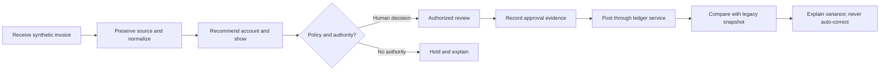

# Enterprise viewpoint

## Purpose

This viewpoint describes fictional organizational roles and target financial policies. It is not a statement of implemented or VectorOne functionality.

## Roles

- Tour controller: accountable for material approval and reconciliation review.
- Production manager: supplies show context and approves within delegated policy.
- Tour manager: supplies missing operational context; no posting authority.
- Executive producer: receives material exceptions; read-oriented.
- Auditor: reviews evidence; read-only.
- Administrator: configures policy and identity; no implicit approval authority.

## Business process

## Policies

- **E-01:** no financial write without a valid server-checked authorization path.
- **E-02:** posted entries are never edited; corrections use reversal and replacement.
- **E-03:** channel messages request action but cannot grant authority.
- **E-04:** autonomy remains explicitly scoped and reversible.
- **E-05:** every business action links to source evidence.
- **E-06:** demo channels are simulated and send no real money or messages.

## Current implementation

The runnable demo includes synthetic actors, cue review, server-side approval checks, posting with idempotency, reconciliation explanations, and an audit trail. Persistence is a seeded process-memory store, not a production database.
