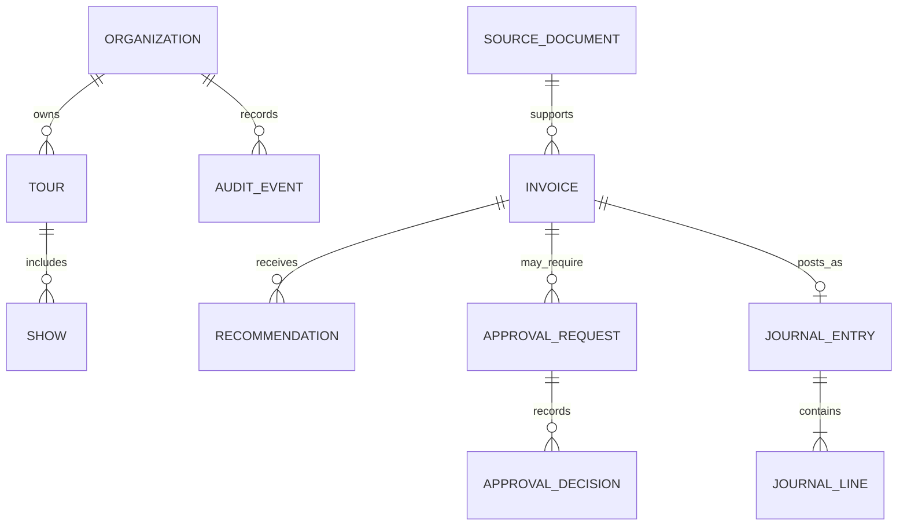

# Information viewpoint

## Purpose

This view describes target data and invariants. The current code only contains an in-memory journal-draft value model.

## Invariants

- Every persisted future business record is scoped to an organization.
- Python `Decimal` owns calculation; API amounts are strings; future database amounts use `NUMERIC(18,2)`.
- A journal draft has at least two lines.
- Each line has exactly one positive debit or credit side.
- Debits equal credits in one currency.
- Posted entries are immutable in the target design; corrections use reversals.
- Approval decisions record actor, role, policy version, state version, reason, and timestamp.

## Status

No database schema or persistent lifecycle exists in the foundation milestone.
