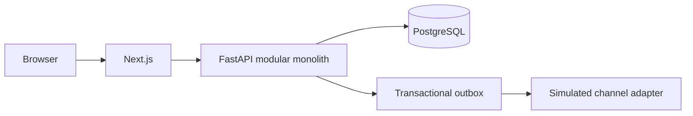

# Engineering viewpoint

## Target topology

This topology is target architecture. The current process has no database, frontend, worker, or channel adapter.

## Target reliability rules

- Approval, posting, audit, idempotency, and outbox should share a transaction where consistency requires it.
- Channel delivery is asynchronous and must not alter the ledger.
- Retries are idempotent and observable.
- Public/serverless state is durable in a database, never process memory or local files.
- Correlation IDs and structured logs accompany operations; secrets never enter logs.
- Failures in authorization, policy, balance, or persistence fail closed.
