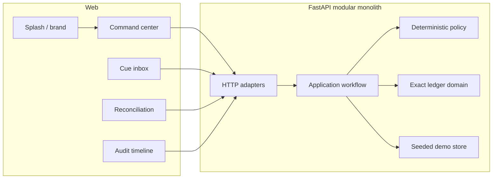

# CueClose architecture

## Modular monolith



## Repository layout

```text
CueClose/
  api/                 FastAPI service and domain
    app/api/           Transport schemas and routes
    app/application/   Use-cases / workflow orchestration
    app/domain/        Money, ledger, policy, models
    app/infrastructure Seeded in-memory store
    tests/             Contract and domain tests
  web/                 Next.js branded workspace
  brand/               Logo, mark, color tokens
  docs/                RM-ODP views, ADRs, diagrams
  scripts/             Local run helpers
```

## Design constraints

- Models recommend; they do not post.
- Money is `Decimal` in domain code and decimal strings on the wire.
- Approvals are server-authorized and audited.
- Posted journals are immutable; reconciliation explains variance.
- Demo data is synthetic; channels are simulated.
